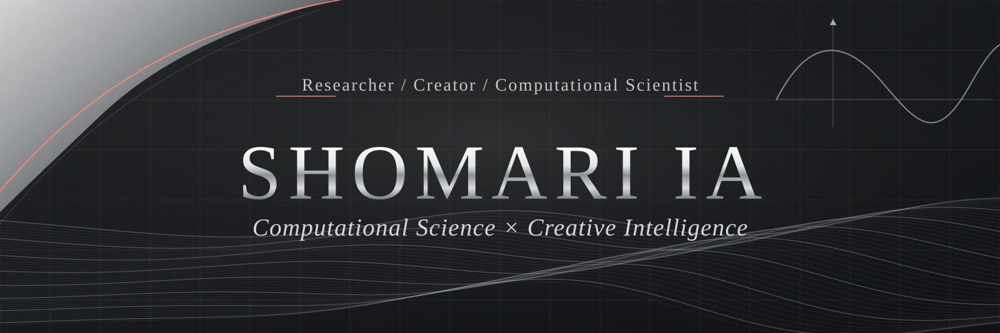
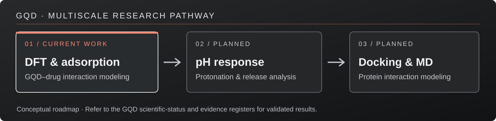

### Scientific Rigor. Computational Intelligence. Creative Innovation.

**Computational Data-Enabled Science & Engineering**  
**Computational Biology & Bioinformatics · Jackson State University**

[Explore GQD Dissertation](https://github.com/shomari-ia/gqd-dissertation) · [Scientific Status](https://github.com/shomari-ia/gqd-dissertation/blob/main/SCIENTIFIC_STATUS.md) · [Research Journal](https://github.com/shomari-ia/gqd-dissertation/blob/main/LAB_JOURNAL.md)

---

## Computational Science Meets Creative Intelligence

I am **Shomari A. Johnson**, a PhD candidate at **Jackson State University** working at the intersection of computational biology, bioinformatics, quantum chemistry, and scientific computing.

My research brings together **molecular modeling, reproducible computation, and data-enabled approaches** to examine complex problems in nanomaterials and drug delivery. I also explore how intelligent systems, visual storytelling, and thoughtful design can make technically demanding research clearer and more accessible.

I believe rigorous science and creativity should reinforce each other: **the research must be defensible, and the presentation should make its logic visible.**

## Featured Research · GQD Dissertation

### pH-Responsive Carboxyl-Functionalized Graphene Quantum Dots for Anticancer Drug Delivery

My dissertation investigates a carboxyl-functionalized graphene quantum dot as a candidate nanocarrier for four anticancer compounds: **erlotinib, gefitinib, venetoclax, and ABT-737**. The multiscale research framework connects quantum-mechanical modeling of drug adsorption to pH-dependent interactions and planned biological modeling.

The **GQD repository** is the authoritative scientific record. It documents calculation inputs, computational workflows, current scientific status, acceptance criteria, and evidence provenance. This personal profile is a *portfolio*, not a replacement for those records.

**Explore:**

- [GQD Dissertation Repository](https://github.com/shomari-ia/gqd-dissertation)
- [Current Scientific Status](https://github.com/shomari-ia/gqd-dissertation/blob/main/SCIENTIFIC_STATUS.md)
- [Scientific Evidence Register](https://github.com/shomari-ia/gqd-dissertation/blob/main/scientific_evidence_register.tsv)
- [Computational Workflow](https://github.com/shomari-ia/gqd-dissertation/blob/main/docs/computational_workflow.md)
- [Acceptance Gates](https://github.com/shomari-ia/gqd-dissertation/blob/main/docs/acceptance_gates_v2.md)

## Research and Technical Interests

| Research Domain | Areas of Interest |
|:--|:--|
| **Computational Chemistry** | Density functional theory, molecular structure, noncovalent interactions |
| **Bioinformatics and Computational Biology** | Molecular targets, biological interpretation, computational methods |
| **Scientific Computing** | Linux/HPC, Gaussian 16, Python, reproducible workflows |
| **Molecular Simulation** | Molecular docking and molecular dynamics within the multiscale research plan |
| **Creative Intelligence** | Scientific visualization, interactive learning, research communication, intelligent-agent design |

## My Approach

**Model Thoughtfully.** Define the question, the molecular system, and the limits of the method.

**Validate Rigorously.** Distinguish completed computations from scientifically accepted conclusions.

**Document Reproducibly.** Preserve provenance, methods, corrections, and scientific decisions.

**Communicate Creatively.** Make complex research intuitive without overstating the evidence.

## Beyond The Calculation

I am developing a coordinated scientific presentation identity across dissertation materials, molecular visualizations, scientific posters, research journals, and a conceptual intelligent-agent character called **AXIOM**.

AXIOM is a **creative communication identity**, not a computational result, scientific validator, or representation of an autonomous research system.

---

**From Computational Investigation to Scientific Understanding.**

Visuals in this profile are conceptual branding and research maps—not validated molecular structures or scientific figures. Current research status is maintained in the linked dissertation repository.

